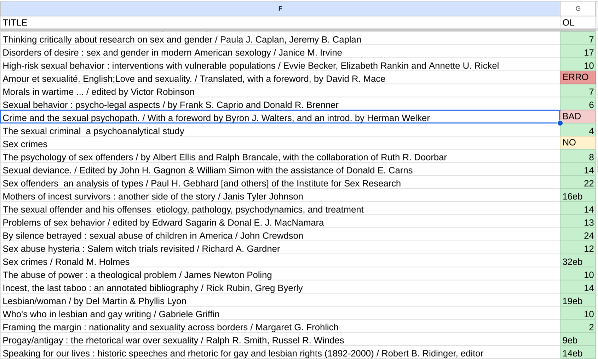

# Library Catalog Scraper

Checks a whole library inventory against the catalog so librarians do not have to do it by hand.

## Why I built it

When librarians weed a collection, they check every book by hand: how many other schools hold it, and is there an ebook. I saw that at the Denison University Library and built this to take it over. Most of the staff now run it twice a year.

## How it works

1. Upload an `.xlsx` file and pick a start row and an end row.
2. Playwright opens the catalog in a headless Chromium browser and searches each title.
3. A title check (about 80 percent word overlap) and an author name check both have to pass before a result counts as the right book.
4. It counts how many schools hold the book, follows linked records, and checks for an ebook.
5. Each result is written into the `OL` column and color coded. Progress streams to the page live.

When it cannot be sure, it never guesses. It labels the row so a person can review it.

## Your spreadsheet

Row 1 needs two columns:

- `TITLE`: written as `Title / Author`, with the author after a forward slash. A row with no author falls back to a title only search.
- `OL`: where the results go.

Start and end rows match the Excel row numbers, and row 1 is the header.

## Results

| Value | Meaning |
|---|---|
| `12` | 12 schools hold it |
| `eb` | Ebook only |
| `12eb` | 12 schools plus an ebook |
| `NO RESULTS` | Nothing in the catalog |
| `BAD SEARCH` | The top result was a different book |
| `NO AUTHOR` | No author given and the title was not enough to confirm a match |
| `ERROR` | The search failed twice |
| `N/A` | Empty title |

## Stack

Python, Flask, Playwright, openpyxl, pandas, plain HTML/CSS/JS, and Server-Sent Events for the progress bar.

## Scope

This is a working prototype built around one librarian's weeding workflow and Denison's Primo catalog. It can misfire on messy titles or unusual formatting.
